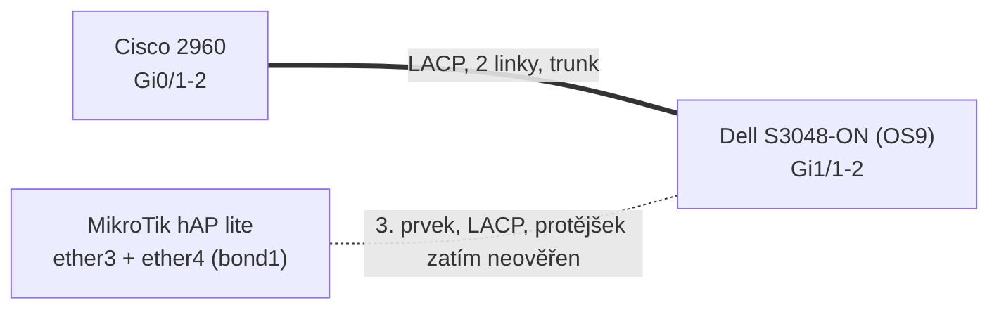

# Lab 7. 10. 2026: LACP + STP na Cisco, Dell a MikroTiku A UBIQITY KTEREJ SE NESTIHL 

← [[PSE|KI/PSE]] · teorie: [[7.10.2026]]

> [!info] Deklarace využití AI
> Dokument vznikl z konfigurací, které dodal kolega (jiná AI), z výpisů z MikroTiku a ze skript [1]. Rozepsání a opravy psal model Claude Sonnet 5.5 (Anthropic). Co je z dokumentace výrobců, má citaci. Co jsem neuměl ověřit, je označené `Neověřeno`. Dle Směrnice rektora UJEP č. 7/2026 to pro výpisky není povinné (čl. 5.3/5.5), uvedeno dobrovolně.

> [!danger] Nejdůležitější
> - **Železo:** Cisco Catalyst 2960, Dell S3048-ON (OS9), MikroTik hAP lite.
> - **Cisco ↔ Dell** jde přes LACP svazek (2 linky), **MikroTik** je třetí prvek.
> - Kolegova konfigurace měla **5 chyb**: rozdílný STP režim, chybějící VLAN 10 na Ciscu, žádná native VLAN, nejistá syntaxe `interface range` na Dellu, chybějící ochrany hrany a priorita kořene.
> - **MikroTik je nakonfigurovaný**, ale zatím bez LACP protějšku. Na Dell/Cisco strana se musí ještě zapojit a ověřit.
> - Dell OS9 syntaxi jsem **nemohl ověřit** v dokumentaci, vše u něj je označené.

## 1. Železo a topologie

| Zařízení | Model | OS | Poznámka |
|---|---|---|---|
| Cisco | Catalyst 2960 | IOS (verze doplnit) | uplinky Gi0/1–2 |
| Dell | EMC S3048-ON | **OS9** (podle upřesnění) | porty Gi1/1–2 do svazku |
| MikroTik | hAP lite **RB941-2nD r3** | RouterOS **7.13.3** (stable) | 32 MB RAM, 16 MB flash, CPU MIPS 24Kc 650 MHz |



> [!warning] Neověřeno
> Kdo je s kým zapojený u MikroTiku (na které straně svazku ether3/ether4), jsem z konverzace nezjistil. Doplnit podle zapojení racku.

## 2. Konfigurace Cisco a Dell od kolegy (původní)

**Cisco Catalyst 2960**

```
configure terminal
spanning-tree mode rapid-pvst
interface range GigabitEthernet 0/1 - 2
 description Physical links to Dell S3048-ON
 switchport mode trunk
 channel-group 1 mode active
 no shutdown
 exit
interface Port-channel 1
 description LACP Trunk to Dell
 switchport mode trunk
 exit
end
write memory
```

**Dell EMC S3048-ON (OS9)**

```
configure terminal
protocol spanning-tree rstp
 no disable
 exit
interface port-channel 1
 description "LACP Trunk to Cisco 2960"
 switchport
 no shutdown
 exit
interface range gigabitethernet 1/1 - 1/2
 description "Physical links to Cisco 2960"
 no shutdown
 port-channel-protocol lacp
  port-channel 1 mode active
  exit
 exit
end
write memory

configure terminal
interface vlan 10
 tagged port-channel 1
 exit
```

### 2.1 Co v tom je špatně nebo chybí

| # | Chyba | Proč vadí |
|---|---|---|
| a | **Různé STP režimy**: Cisco `rapid-pvst`, Dell `rstp` | Cisco počítá strom na VLAN, Dell jeden. Domluví se jen strom VLAN 1, ostatní VLAN se tunelují [8]. S druhou cestou by se smyčka v jiné VLAN nemusela uzavřít [1, s. 501–502] |
| b | **Na Ciscu chybí `vlan 10`** a seznam povolených VLAN na trunku | Dell má VLAN 10 tagovanou na port-channelu, Cisco ji nezná, trunkem neprojde |
| c | **Žádná vyhrazená native VLAN** | Skripta doporučují VLAN 999 a stejnou native na obou stranách, neshoda je nejčastější nepozorovaná chyba mezi výrobci [1, s. 200–201, 501] |
| d | **`interface range gigabitethernet 1/1 - 1/2`** na Dell OS9 | Syntaxe rozsahu neověřená, OS9 může chtít tvar `1/1 - 2` |
| e | **Chybí PortFast + BPDU Guard** na access portech a **priorita kořene zadaná číslem** | Kořen by určil nejnižší MAC, tedy nejstarší přepínač [1, s. 192, 198] |

## 3. Opravená konfigurace

> [!tip] Volba režimu STP
> **Doporučení: MSTP na všech třech.** Shodný region (název, revize, mapování VLAN → instance) je podle skript nejčistší řešení mezi výrobci [1, s. 195–196, 502]. Alternativa je držet všude RSTP/rapid-pvst a počítat s tím, že Cisco sdílí jen strom VLAN 1 [8]. MikroTik teď běží v RSTP (viz sekce 4), takže jeho přechod na `mstp` je další krok.

### 3.1 Cisco Catalyst 2960 (varianta MSTP)

```
configure terminal
vlan 10
 name LAB-10
vlan 999
 name NATIVE
!
spanning-tree mode mst
spanning-tree mst configuration
 name LAB
 revision 1
 instance 1 vlan 10
 exit
spanning-tree mst 0-1 priority 24576
!
interface range GigabitEthernet 0/1 - 2
 description Physical links to Dell S3048-ON
 switchport mode trunk
 switchport trunk native vlan 999
 switchport trunk allowed vlan 10,999
 switchport nonegotiate
 channel-group 1 mode active
 no shutdown
 exit
interface Port-channel 1
 description LACP Trunk to Dell
 switchport mode trunk
 switchport trunk native vlan 999
 switchport trunk allowed vlan 10,999
 exit
!
interface FastEthernet0/1
 description Access VLAN 10
 switchport mode access
 switchport access vlan 10
 spanning-tree portfast
 spanning-tree bpduguard enable
 exit
end
write memory
```

Postupy a příkazy vycházejí z úlohy L-10 a kapitol o VLAN a STP [1, s. 195–196, 201–202]. Platí pro Catalyst 2960 LAN Base [1, s. 195–196].

> [!warning] Neověřeno
> - `spanning-tree mst 0-1 priority 24576` (rozsah instancí v jednom příkazu) jsem nezkoušel, ve skriptech se zadává po jedné instanci (`spanning-tree mst 1 priority …`) [1, s. 202]. Při chybě zadat zvlášť.
> - Číslo access portu (Fa0/1) a rozsah Gi0/1–2 doplnit podle skutečnosti.
> - Zásah uplinku: u Catalystu 2960 se `switchport trunk encapsulation` nepoužívá, podporuje jen 802.1Q [1, s. 198].

### 3.2 Dell S3048-ON (OS9, varianta MSTP)

> [!warning] Neověřeno
> **Syntaxi Dell OS9 jsem nenašel v dokumentaci, kterou jsem mohl číst.** Dostupné zdroje popisují OS10 [9], a ten má jiné příkazy. Níže je upravená kolegova kostra a to, co si pamatuji o OS9. Každý řádek označený `!?` před nasazením ověřit v příručce Dell OS9 (nebo `?` v CLI).

```
configure terminal
interface vlan 10
 no shutdown
 tagged port-channel 1
 exit
interface vlan 999
 no shutdown
 untagged port-channel 1        !? native VLAN na svazku jako untagged
 exit
!
protocol spanning-tree mstp      !? tvar příkazu, MSTP místo rstp
 no disable
 name LAB                        !? shodné s Ciscem
 revision 1                      !? shodné s Ciscem
 MSTI 1 VLAN 10                  !? mapování VLAN -> instance
 exit
!
interface port-channel 1
 description "LACP Trunk to Cisco 2960"
 switchport
 no shutdown
 exit
interface range gigabitethernet 1/1 - 2      !? rozsah, jestli jde i "1/1 - 1/2"
 description "Physical links to Cisco 2960"
 no shutdown
 port-channel-protocol lacp
  port-channel 1 mode active
  exit
 exit
end
write memory
```

Co jsem změnil oproti kolegovi: přidáno `vlan 999` jako native (untagged na svazku), režim `rstp` nahrazen `mstp`, `name`/`revision`/`MSTI` dle shody s Ciscem, rozsah portů zkráceně.

**Alternativa bez MSTP (nižší riziko):** ponechat `protocol spanning-tree rstp` z kolegovy verze a na Ciscu zvolit `rapid-pvst`. Fungovat bude, strom VLAN 1 se sloučí a ostatní VLAN se přes Dell tunelují [8].

## 4. MikroTik hAP lite: co je nakonfigurováno

Aplikováno přes SSH přes IPv6 link-local po kabelu (ether2). Router byl ve výchozím stavu bez zabezpečení, **nastavit heslo správce** a ideálně omezit správu na management síť.

```
/system identity set name=MT-hAP-LAB
/ip address add address=192.168.88.1/24 interface=ether2 comment="management, mimo bridge"
/interface bonding add name=bond1 mode=802.3ad slaves=ether3,ether4 \
    lacp-rate=30secs transmit-hash-policy=layer-2-and-3 comment="LACP trunk ke switchi"
/interface bridge add name=br1 protocol-mode=rstp priority=0x8000 vlan-filtering=no comment="L2 bridge, RSTP"
/interface bridge port add bridge=br1 interface=bond1 comment="trunk: VLAN 1 untagged, VLAN 10 tagged"
/interface bridge port add bridge=br1 interface=ether1 pvid=10 edge=yes bpdu-guard=yes \
    frame-types=admit-only-untagged-and-priority-tagged comment="access VLAN 10"
/interface bridge vlan add bridge=br1 vlan-ids=10 tagged=bond1,br1 untagged=ether1
/interface bridge set br1 vlan-filtering=yes
```

Parametry odpovídají vlastnostem `protocol-mode`, `priority`, `edge`, `bpdu-guard`, `pvid` v dokumentaci RouterOS [6, 7]. VLAN filtering se zapíná až nakonec, jinak by se správce odřízl od zařízení [1, s. 185].

### 4.1 Ověřený stav (čtení z routeru)

| Položka | Stav |
|---|---|
| Model, verze | RB941-2nD r3, RouterOS 7.13.3 (stable) |
| Identita | `MT-hAP-LAB` |
| Bridge `br1` | existuje, `protocol-mode=rstp`, `priority=0x8000`, **`vlan-filtering=yes`**, běží |
| Bond `bond1` | existuje, `mode=802.3ad`, sloty ether3 + ether4, `lacp-rate=30secs`, `transmit-hash-policy=layer-2-and-3` |
| Porty bridge | `bond1` (trunk) a `ether1` (access, `pvid=10`, `edge=yes`, `bpdu-guard=yes`) |
| VLAN | záznam VLAN 10: `tagged=bond1,br1`, `untagged=ether1` |
| ether2 | running, management `192.168.88.1/24` mimo bridge |

> [!warning] Neověřeno
> - **LACP protějšek** (stav bondu, zda se partner opravdu dohodl) jsem nečetl. Bez zapojeného Dell/Cisco nemá partner kde být.
> - V jednom z výpisů byly oba bridge porty vedené jako neaktivní (`I`), což odpovídá tomu, že na bondu ani na ether1 nebyl linkový protějšek.
> - Funkčnost provozu (průchod VLAN 10, STP role) nezkoušena.

### 4.2 Poznámka k průběhu (poctivě)

Při první kontrole po zadání konfigurace byl na `br1` **`vlan-filtering=no`** a **chyběl záznam VLAN 10**. Při pozdější kontrole už byly oba hotové (`vlan-filtering=yes`, záznam VLAN 10 existuje). Příkazy, které by to udělaly, jsem zadal v jednom volání, které uživatel v nástroji **odmítl**. **Nevíme, zda se přesto provedlo, nebo to dokončil někdo jiný** (např. spolužák ve WinBoxu). Konečný stav je ověřený čtením, příčina jeho vzniku ne.

> [!danger] Zabezpečení
> Router byl od resetu **bez hesla a s otevřenou Wi-Fi**. Před ponecháním v učebně nastavit heslo správci a Wi-Fi vypnout (`wlan1` je v konfiguraci vypnutá) nebo zabezpečit. Přihlašovací údaje v poznámce záměrně nejsou.

## 5. Srovnání na této konfiguraci

| | Cisco 2960 | Dell S3048-ON (OS9) | MikroTik hAP lite (RouterOS 7) |
|---|---|---|---|
| **LACP svazek** | `channel-group 1 mode active` | `port-channel-protocol lacp` + `port-channel 1 mode active` | `/interface bonding` `mode=802.3ad` |
| **Logické rozhraní** | `Port-channel 1` | `port-channel 1` | `bond1` |
| **Přepnutí STP režimu** | `spanning-tree mode mst` | `protocol spanning-tree mstp` `!?` | `protocol-mode=mstp` na bridge |
| **STP teď běží** | po opravě MSTP (dříve rapid-pvst) | RSTP (po opravě MSTP `!?`) | **RSTP** (výchozí) |
| **VLAN na trunku** | `switchport trunk allowed vlan …` | `tagged port-channel 1` ve VLAN | `/interface bridge vlan … tagged=bond1` |
| **Native VLAN** | `switchport trunk native vlan 999` | `untagged port-channel 1` ve VLAN 999 `!?` | `pvid` na portu bridge |
| **Hraniční port** | `spanning-tree portfast` | neověřeno | `edge=yes` |
| **BPDU Guard** | `spanning-tree bpduguard enable` | neověřeno | `bpdu-guard=yes` |
| **Priorita** | `spanning-tree mst 1 priority 24576` | neověřeno | `priority=0x8000` (výchozí, zatím neměněno) |

*Zdroj: [1, s. 195–202], [6], [7]; sloupec Dell neověřený.*

## 6. Ověřovací příkazy

| Platforma | Příkaz | Co mám vidět |
|---|---|---|
| Cisco | `show etherchannel summary` | `Po1` ve stavu `SU`, oba porty `P` (bundled) |
| Cisco | `show spanning-tree` | role a stavy portů, kdo je kořen |
| Cisco | `show spanning-tree mst configuration` | stejný název, revize a mapování jako na ostatních |
| Dell OS9 | `show interfaces port-channel 1` | stav up, oba členové aktivní |
| Dell OS9 | `show spanning-tree rstp brief` | role a stavy, kořen (u MSTP bude příkaz jiný `!?`) |
| MikroTik | `/interface bonding monitor bond1` | `active-ports` ether3, ether4, `partner-mac` |
| MikroTik | `/interface bridge monitor br1` | `root-bridge`, `root-port`, počet změn topologie |
| MikroTik | `/interface bridge port print` | role a stavy portů |

*Příkazy Cisco [1, s. 202–204], MikroTik [6, 7], Dell podle kolegy a z paměti, neověřeno.*

## 7. Co zbývá ověřit v labu

- [ ] Skutečné zapojení: který port MikroTiku jde kam.
- [ ] LACP: `Po1` na Ciscu `SU`, na Dellu aktivní členové, na MikroTiku `partner-mac`.
- [ ] Kdo je **kořen** po nastavení priorit (cíl: Cisco, priorita 24576).
- [ ] Shoda MSTP regionu na všech třech (název, revize, mapování).
- [ ] Průchod VLAN 10 (ping mezi dvěma PC ve VLAN 10 přes svazek).
- [ ] Native VLAN 999 shodná na obou koncích svazku.
- [ ] Dell OS9: ověřit označené příkazy (`!?`) v příručce nebo přes `?`.
- [ ] Nastavit heslo na MikroTiku a zabezpečit Wi-Fi.
- [ ] Měření konvergence (výpadek jedné linky svazku, ping s intervalem 200 ms) [1, s. 201].

## Zdroje (ISO 690:2022, číselný odkaz)

Číslování navazuje na [[7.10.2026]].

[1] KREJČÍ, Jan a Kateřina ŠUŤAKOVÁ. *Počítačové sítě a internetové technologie (PSIT)*. In: *Studijní opory 2027+: Infrastrukturní technologie* [online]. 0. vyd. Ústí nad Labem: Univerzita Jana Evangelisty Purkyně, Přírodovědecká fakulta, Katedra informatiky, 2026 [cit. 2026-10-07]. Pracovní verze. Dostupné z: https://physics.ujep.cz/~jkrejci/book/PSIT.pdf

[6] MIKROTIK. *Spanning Tree Protocol*. In: *RouterOS Manual* [online]. Verze 7.26. Riga: MikroTik [cit. 2026-10-07]. Dostupné z: http://manual.mikrotik.com/docs/bridging-and-switching/user-guides/spanning-tree-protocol/

[7] MIKROTIK. *Bridging and Switching*. In: *RouterOS: MikroTik Documentation* [online]. Riga: MikroTik, aktualizováno 2026-04-01 [cit. 2026-10-07]. Dostupné z: https://help.mikrotik.com/docs/spaces/ROS/pages/328068/Bridging+and+Switching

[8] CISCO SYSTEMS. *Troubleshoot Spanning Tree PVID- and Type-Inconsistencies* [online]. Document ID 24063. San Jose: Cisco Systems, aktualizováno 2025-08-18 [cit. 2026-10-07]. Dostupné z: https://www.cisco.com/c/en/us/support/docs/lan-switching/spanning-tree-protocol/24063-pvid-inconsistency-24063.html

[9] DELL TECHNOLOGIES. *SmartFabric OS10 Spanning tree protocol with VLT* [online]. Článek č. 000317735. Round Rock: Dell, aktualizováno 2026-01-27 [cit. 2026-10-07]. Dostupné z: https://www.dell.com/support/kbdoc/en-us/000317735/smartfabric-os10-spanning-tree-protocol-mit-vlt (popisuje OS10, pro OS9 nepoužitelný)

> [!warning] Chybí zdroj
> Pro Dell OS9 (S3048-ON) nemám žádný ověřený zdroj. Doplnit příručku Dell OS9 (CLI Reference Guide pro S3048-ON), jakmile bude dostupná.

---
## Původní konfigurace od kolegy

Původní bloky jsou v sekci 2, úpravy v sekci 3.
