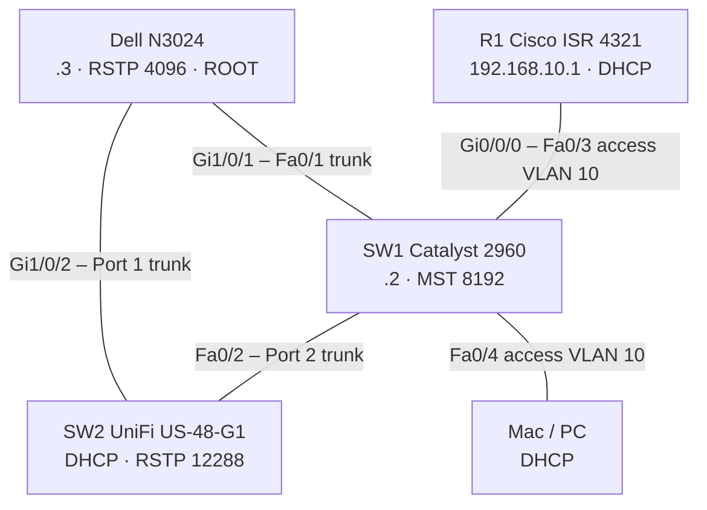

# Lab Trojúhelník: kompletní návod k zopakování

← [[PSE|KI/PSE]]

> [!info] Deklarace využití AI
> Topologii, zapojení a výstupy z konzolí dodal Zdeněk. Postup, konfigurace a testy vedl model Claude Sonnet 5.5 (Anthropic) během labu v chatu. Co jsem neověřil, je označeno `Neověřeno`. Dle Směrnice rektora UJEP č. 7/2026 to pro výpisky není povinné (čl. 5.3/5.5), uvedeno dobrovolně.


## Adresace a rychlé testy (tahák)

> [!success] Síť `192.168.10.0/24`, VLAN 10 `LAN`
> Maska `255.255.255.0`, brána **`192.168.10.1`** (R1), DNS `8.8.8.8`. Klient si adresu vezme z DHCP (R1), případně nastav staticky **mimo `.1`-`.9`** (ty jsou rezervované).

| Zařízení                 | Rozhraní     | IP                       | Maska | Brána | Přidělení                 | MAC                     |
| ------------------------ | ------------ | ------------------------ | ----- | ----- | ------------------------- | ----------------------- |
| **R1** Cisco ISR 4321    | Gi0/0/0      | `192.168.10.1`           | /24   | –     | statická, DHCP server     | `60:26:aa:a1:48:30`     |
| **SW1** Cisco 2960-24    | Vlan10       | `192.168.10.2`           | /24   | `.1`  | statická                  | `3c:5e:c3:8d:51:c1`     |
| **Dell** N3024           | Vlan10       | `192.168.10.3`           | /24   | `.1`  | statická                  | `f4:8e:38:01:13:06`     |
| **UniFi** US-48-G1 (SW2) | mgmt VLAN 10 | `192.168.10.10` (v labu) | /24   | `.1`  | **DHCP** (může se změnit) | `fc:ec:da:40:e9:a4`     |
| **PC / Mac**             | síťovka      | `192.168.10.11` (v labu) | /24   | `.1`  | DHCP, od `.10` výš        | Mac `6c:1f:f7:60:aa:8b` |
| rezerva                  |              | `.4`-`.9`                |       |       | nikomu nepřidělovat       |                         |

> [!warning] UniFi adresa není pevná
> UniFi dostal `.10` z DHCP. Po rebootu může dostat jinou. Aktuální adresu zjistíš na R1: `show ip dhcp binding` (hledej MAC `fc:ec:da:40:e9:a4`).

### Kam zapojit PC, aby byl ve VLAN 10
**Kamkoliv, kromě uplinků.** Všechny běžné porty jsou access VLAN 10.

| Switch | Porty pro PC (VLAN 10) | Uplinky, **nezapojovat PC** |
|---|---|---|
| **SW1 Cisco** | Fa0/3-24, Gi0/1-2 (Fa0/3 = R1) | Fa0/1 (Dell), Fa0/2 (UniFi) |
| **Dell N3024** | Gi1/0/3-24, Te1/0/1-2 | Gi1/0/1 (SW1), Gi1/0/2 (UniFi) |
| **UniFi US-48-G1** | Port 3-52 (včetně SFP 49-52) | Port 1 (Dell), Port 2 (SW1) |

> [!warning] Doplněno z Claude
> Stav portů na **UniFi** je ověřený výstupem (`show vlan port`, kontrola portů 3, 24, 48, 49, 52 a uplinků 1, 2). Stav na **SW1 a Dellu** nevidím, příkazy zadával Zdeněk sám, výsledek jsem nekontroloval. Ověř `show vlan brief` (Cisco) a `show vlan` (Dell): porty musí být ve VLAN 10 `LAN`, ne v `default`.

PC ve VLAN 1 (nenastavený port) dostane `169.254.x.x` nebo nic a nic z tabulky nepůjde.

**Výsledek z labu:** notebook zapojený do switche dostal z DHCP `192.168.10.12` (MAC `00:e0:6c:7a:09:7b`), viditelný v ARP na Macu.

### Co zkoušet (z PC / z jednotlivých switchů)

**Z PC (Windows / Mac):**
```
ping 192.168.10.1     (R1)
ping 192.168.10.2     (SW1)
ping 192.168.10.3     (Dell)
ping 192.168.10.10    (UniFi)
```
Windows: `ipconfig`, Mac: `ifconfig en8`. SSH na UniFi: `ssh ubnt@192.168.10.10` (heslo po továrním resetu `ubnt`).

**Z R1 / SW1 (Cisco IOS):**
```
ping 192.168.10.3
ping 192.168.10.10
show ip dhcp binding          (jen R1)
show arp                      (R1)
show mac address-table        (SW1)
```

**Z Dellu (DNOS6):**
```
ping 192.168.10.1
ping 192.168.10.2
ping 192.168.10.10
show arp
show mac-address-table
```

**Z UniFi (po SSH, v běžném shellu, ne v `telnet localhost`):**
```
ping -c 3 192.168.10.1
ping -c 3 192.168.10.2
ping -c 3 192.168.10.3
```

Očekávání: vše **0 % ztráty** (první paket může padnout kvůli ARP). V labu 15. 10. šlo všechno 20/20.

### Co v síti zatím **není**
- Žádný ping ven (internet): R1 nemá WAN ani NAT, `dns-server 8.8.8.8` se jen rozdá klientům.
- SSH ani Telnet na R1, SW1 (jen konzole). Dell má telnet s přihlášením, UniFi SSH.
- Další VLANy a inter-VLAN routing (jen VLAN 10 a nativní VLAN 1).

**Cíl:** router R1 a tři switche (Cisco, Dell, UniFi) zapojené do trojúhelníku, VLAN 10, DHCP na routeru, STP s rootem na Dellu, bez smyčky.
**Stav:** funkční a otestováno (viz kapitola Testy). Jedna věc je odvozená, ne přímo viděná (blokovaný port).
**Konfigurace se neukládá** (`wr` se nepoužívá), po vypnutí se vymaže. UniFi má změny jen v RAM do rebootu.

## 1. Potřebuješ
- Cisco ISR 4321 (**R1**), Cisco Catalyst 2960-24 (**SW1**), Dell EMC **N3024** (DNOS 6.5.4.23), Ubiquiti UniFi Switch 48 (**SW2**, model `US-48-G1`, firmware 7.2.123)
- PC se sériovým portem, terminál (PuTTY / `screen`), případně druhý počítač do sítě
- Kabely: normální (straight) mezi switchi. Konzole: RJ45 = rollover, mini-USB = běžný USB.
- **Terminál Cisco a Dell:** 9600 baud, 8 data bits, 1 stop bit, parity None, **flow control None** (XON/XOFF konzoli blokuje).
- Mac: `ls /dev/tty.usb*`, `screen /dev/tty.usbserial-XXXX 9600`. Windows: PuTTY Serial, COM ve Správci zařízení.

## 2. Adresování
> [!warning] Doplněno z Claude
> Rozsah navrhl model, zadání ho neurčuje.

| Zařízení    | Adresa                | Poznámka           |
| ----------- | --------------------- | ------------------ |
| R1 Gi0/0/0  | 192.168.10.1/24       | brána, DHCP server |
| SW1 Vlan10  | 192.168.10.2/24       | statická           |
| Dell Vlan10 | 192.168.10.3/24       | statická           |
| SW2 UniFi   | z DHCP (v labu `.10`) | management VLAN 10 |
| klienti     | z DHCP od `.10` výš   | Mac měl `.11`      |

DHCP pool vynechává `.1`-`.9`. VLAN 10 `LAN`.

## 3. Schéma

![[lab-trojuhelnik-schema-2026-10-15.png]]

*Diagram z NetSketch (stav po uzavření trojúhelníku, PC1 = MacBook v SW1 Fa0/4). Projekt: [[lab-trojuhelnik-2026-10-15.netsketch]].*

> [!warning] Doplněno z Claude
> Soubor `.netsketch` v poznámce je uložený ve **14:33**, tedy před zapojením třetího kabelu (Dell Gi1/0/2 ↔ UniFi Port 1). V obrázku výše už je kabel zakreslený, v souboru nemusí být. Před dalším použitím ho ulož znovu z NetSketch.



| Z | Do | Typ |
|---|---|---|
| Dell Gi1/0/1 | SW1 Fa0/1 | trunk |
| SW1 Fa0/2 | UniFi Port 2 | trunk |
| Dell Gi1/0/2 | UniFi Port 1 | trunk (třetí kabel, uzavírá trojúhelník) |
| SW1 Fa0/3 | R1 Gi0/0/0 | access VLAN 10 |
| SW1 Fa0/4 | PC | access VLAN 10 |

> [!warning] Pravidlo
> Třetí kabel (Dell Gi1/0/2 ↔ UniFi Port 1) zapoj **až úplně nakonec**, až jsou **oba jeho konce nastavené** (trunk na Dellu, VLAN 10 tagged na UniFi Port 1). Do té doby je topologie řetěz bez smyčky.

## 4. Postup

### Krok 0: čistý start
Zkontroluj `show running-config`. Pokud tam je cizí konfigurace:
- **Cisco:** `write erase`, `delete flash:vlan.dat` (jen switch), `reload`. Na „Save?" `no`.
- **Dell:** `clear config`, `reload`. Na uložení `n`.
- **UniFi:** reset tlačítkem (asi 10 s), pak 2-3 min bootování.

### Krok 1: R1 (router + DHCP)
```
enable
conf t
hostname R1
no ip domain-lookup
line con 0
 logging synchronous
 exit
interface gi0/0/0
 description LINK-SW1-Fa0/3
 ip address 192.168.10.1 255.255.255.0
 no shutdown
 exit
ip dhcp excluded-address 192.168.10.1 192.168.10.9
ip dhcp pool LAN10
 network 192.168.10.0 255.255.255.0
 default-router 192.168.10.1
 dns-server 8.8.8.8
 exit
end
show ip dhcp pool
show ip dhcp binding
```
Binding je prázdný, dokud si klient nevyžádá adresu.

### Krok 2: SW1 (Cisco 2960)
```
enable
conf t
hostname SW1
no ip domain-lookup
line con 0
 logging synchronous
 exit
vlan 10
 name LAN
 exit
spanning-tree mode mst
spanning-tree mst 0 priority 8192
interface range fa0/1-2
 switchport mode trunk
 exit
interface range fa0/3-4
 switchport mode access
 switchport access vlan 10
 spanning-tree portfast
 spanning-tree bpduguard enable
 exit
interface vlan 10
 ip address 192.168.10.2 255.255.255.0
 no shutdown
 exit
ip default-gateway 192.168.10.1
end
```
Zapoj SW1 Fa0/3 ↔ R1 Gi0/0/0.
**Ověř:** `show interfaces trunk`, `show vlan brief`; z R1 `ping 192.168.10.2` → 100 %.

### Krok 3: Dell N3024 (DNOS6)
```
enable
configure
hostname Dell
vlan 10
 name LAN
 exit
spanning-tree mode rstp
spanning-tree priority 4096
interface vlan 10
 ip address 192.168.10.3 255.255.255.0
 exit
ip default-gateway 192.168.10.1
interface gi1/0/1
 switchport mode trunk
 exit
interface gi1/0/2
 switchport mode trunk
 exit
exit
```
- Varování u `ip default-gateway` je normální (brána se aktivuje, až naběhne Vlan10).
- `vlan database` v DNOS 6.5.4.23 nic nevytváří, použij rovnou `vlan 10`.
- `show ip interface brief` Dell nezná, použij `show ip interface vlan 10`.
- Telnet na Dell chce přihlášení, konfiguruj přes konzoli.

Zapoj Dell Gi1/0/1 ↔ SW1 Fa0/1.
**Ověř:** `show ip interface vlan 10`, `ping 192.168.10.2`, `ping 192.168.10.1`, `show spanning-tree` → „This Switch is the Root", priorita 4096, Gi1/0/1 `FWD Desg`.

### Krok 4: UniFi US-48-G1 (SW2)
**Přístup:** po resetu IP `192.168.1.20`, SSH `ubnt` / `ubnt`. PC dej statickou `192.168.1.10/24` a zapoj ho do libovolného portu (ne do Portu 2, ať se nemíchají sítě). `info` ukáže `Waiting for IP (http://unifi:8080/inform)`, switch čeká na adopci do controlleru, bez controlleru ale funguje.

Pro STP a VLAN slouží CLI: po SSH `telnet localhost`, pak `enable`. CLI hlásí, že změny platí jen do rebootu.

**Zjištění:** RSTP (802.1w) je zapnuté už z továrny, priorita 32768. Nastav prioritu a VLAN:
```
enable
configure
spanning-tree mst priority 0 12288
exit
vlan database
 vlan 10
 vlan name 10 LAN
 exit
configure
interface 0/1
 vlan participation include 10
 vlan tagging 10
 exit
interface 0/2
 vlan participation include 10
 vlan tagging 10
 exit
exit
show vlan
show vlan port 0/1
show vlan port 0/2
show spanning-tree
```
- `vlan database` se zadává v **privilegovaném** módu (ne v `configure`).
- Port se v CLI jmenuje `0/N`, ne Port N.
- V CLI **není** příkaz `ping`. Ping je v běžném shellu po SSH, před `telnet localhost`.

**Management ve VLAN 10:** `network mgmt_vlan 10` přesune správu do VLAN 10 a adresa se přidělí z DHCP na R1 (`192.168.10.10`). Mac na VLAN 1 pak switch nevidí, proto Mac přepoj do SW1 Fa0/4 (VLAN 10). Zapoj UniFi Port 2 ↔ SW1 Fa0/2.
Statický `network parms 192.168.10.4 255.255.255.0 192.168.10.1` se neprojevil, adresu přidělilo DHCP. `Neověřeno`, proč.

### Krok 5: třetí kabel (uzavření trojúhelníku)
Podmínky před zapojením:
1. Dell Gi1/0/2 je `switchport mode trunk` (krok 3).
2. UniFi Port 1 má VLAN 10 tagged (krok 4), ověřeno `show vlan port 0/1`.

Pak zapoj Dell Gi1/0/2 ↔ UniFi Port 1 a počkej asi 20 s.

> [!warning] Co se stane
> UniFi si vybere **Port 1** (přímo do Dellu, gigabit, cena 20000) jako root port místo Portu 2 přes SW1 (cena 400000). Pokud na Portu 1 chybí VLAN 10, přestane být UniFi dostupný, protože jeho management je ve VLAN 10. Oprava: vytáhni kabel z Portu 1, STP se vrátí na Port 2, nastav VLAN 10 a zapoj znovu.

### Krok 6: všechny ostatní porty do VLAN 10 (aby šlo píchat PC kamkoliv)

**SW1 Cisco:**
```
conf t
interface range fa0/3-24
 switchport mode access
 switchport access vlan 10
 spanning-tree portfast
 exit
interface range gi0/1-2
 switchport mode access
 switchport access vlan 10
 spanning-tree portfast
 exit
end
show vlan brief
```
`bpduguard` jsem v tomhle kroku nedal (u Fa0/3 a Fa0/4 je z kroku 2). Bez něj se port nevypne, když tam někdo zapojí switch.

**Dell N3024:**
```
configure
interface range gi1/0/3-24
 switchport mode access
 switchport access vlan 10
 spanning-tree portfast
 exit
interface range te1/0/1-2
 switchport mode access
 switchport access vlan 10
 spanning-tree portfast
 exit
exit
show vlan
```
> [!warning] Doplněno z Claude
> Syntaxe `interface range` na DNOS6 je `Neověřená`. Pokud ji Dell nepřijme, zkus zápis s mezerou (`interface range gi 1/0/3-24`) nebo port po portu.

**UniFi US-48-G1** (SSH, pak `telnet localhost`, `enable`, `configure`; smyčka přes porty 3-52):
```
interface 0/N
 vlan participation include 10
 vlan pvid 10
 vlan participation exclude 1
 exit
```
Pro N = 3 až 52. Uplinky Port 1 a Port 2 zůstanou trunk (VLAN 1 untagged, VLAN 10 tagged). Ověření: `show vlan port 0/N`, má být PVID 10, VLAN 10 `Untagged`, VLAN 1 mezi `Forbidden`. Syntaxe `vlan pvid`/`participation` je z nápovědy CLI (`vlan ?`).

## 5. STP

| Switch | Režim | Priorita |
|---|---|---|
| Dell | RSTP | 4096 (root) |
| SW1 Cisco | **MST**, instance 0, všechny VLANy | 8192 |
| UniFi | RSTP | 12288 |

> [!warning] Doplněno z Claude
> **Proč MST na Ciscu (ne rapid-pvst):** Dell (RSTP) i UniFi mají jeden strom pro všechny VLANy, `rapid-pvst` má strom na VLAN. S `rapid-pvst` se SW1 ve VLAN 10 bral za root, protože BPDU z Dellu nevidí (ve VLAN 1 root viděl správně). MST s jednou instancí se s RSTP baví čistě, na portu je vidět `Bound(RSTP)`. Odvozeno z chování v labu, `Neověřeno` v dokumentaci výrobce.

## 6. Testy a výsledky (15. 10. 2026, z Macu na SW1 Fa0/4)

| Test | Výsledek |
|---|---|
| Ping 20× na R1 `.1` | 0 % ztráty, 0,4-0,9 ms |
| Ping 20× na SW1 `.2` | 0 % ztráty, 0,9-3,9 ms |
| Ping 20× na Dell `.3` | 0 % ztráty, 1,0-1,3 ms |
| Ping 20× na UniFi `.10` | 0 % ztráty, 1,3-10,5 ms |
| Broadcast storm (10 s na portu) | 12 paketů (ARP 2, STP 5, LLDP 1), žádná smyčka |
| MTU 1500 (`ping -s 1472 -D`) | prošlo |
| Traceroute na R1 | 1 hop |
| Root bridge | Dell (`10:00:F4:8E:38:01:13:03`, priorita 4096) |
| UniFi root port | Port 1 (`80:01`), cena cesty 20000 |
| UniFi Port 1 | Up, 1000 Full, RSTP BPDU TX 272 / RX 236 |
| UniFi Port 2 | Up, 100 Full, RSTP BPDU RX 0, **MSTP BPDU RX 350** (z SW1) |

> [!warning] Doplněno z Claude
> **Blokovaný port je odvozený, ne přímo viděný.** UniFi CLI v této verzi nevypisuje role portů. Z výsledků plyne, že blokovaný je **UniFi Port 2** (Alternate): SW1 (priorita 8192) je lepší než UniFi (12288), takže SW1 je na lince SW1–UniFi designated a UniFi Port 2 je non-designated, protože root port je Port 1. Stejně tak nevidím roli Fa0/2 na SW1. Ověř na SW1: `show spanning-tree mst 0`. **Failover test** (vytáhnout kabel a sledovat, že se síť zotaví) jsme neprováděli.

## 7. Řešení problémů

| Příznak | Příčina / řešení |
|---|---|
| Konzole nic nevypíše | flow control None, správný COM, rollover kabel v Console (ne OOB), Enter 2× |
| Link `down` | jiný normální kabel, ověř port v diagramu |
| První ping padne | ARP, zopakuj |
| SW1 se ve VLAN 10 bere za root | použit `rapid-pvst`, přepnout na `mst` (krok 2) |
| `show spanning-tree` na Ciscu „No spanning tree instance exists" | v MST režimu `show spanning-tree mst` |
| Dell `show ip interface brief` chyba | `show ip interface vlan 10` |
| UniFi po třetím kabelu nedostupný | na Portu 1 chybí VLAN 10, vytáhni kabel z Portu 1, nastav, zapoj |
| UniFi `192.168.1.20` neodpovídá | správu už má ve VLAN 10 (adresa z DHCP), nebo reset tlačítkem |
| Mac / notebook neuvidí VLAN 10, `169.254.x.x` | port je ve VLAN 1 (nenastavený), nastav ho podle kroku 6 nebo přepoj do SW1 Fa0/4 |
| UniFi CLI `vlan database` chyba | zadávat v privilegovaném módu, ne v `configure` |
| `ping` v UniFi CLI nejde | ping je v běžném shellu po SSH (před `telnet localhost`) |

## 8. Úklid po labu
Cisco: `write erase`, `delete flash:vlan.dat`, `reload`. Dell: `clear config`, `reload`. UniFi: reboot nebo reset (změny jsou jen v RAM). Mac adaptér zpět: `sudo networksetup -setdhcp "AX88179B"`.
